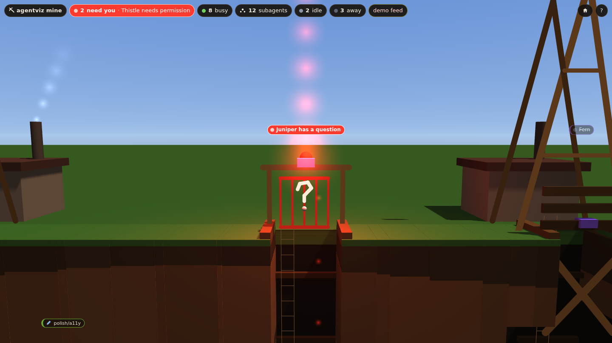
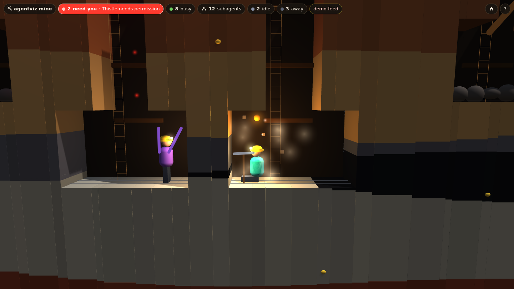
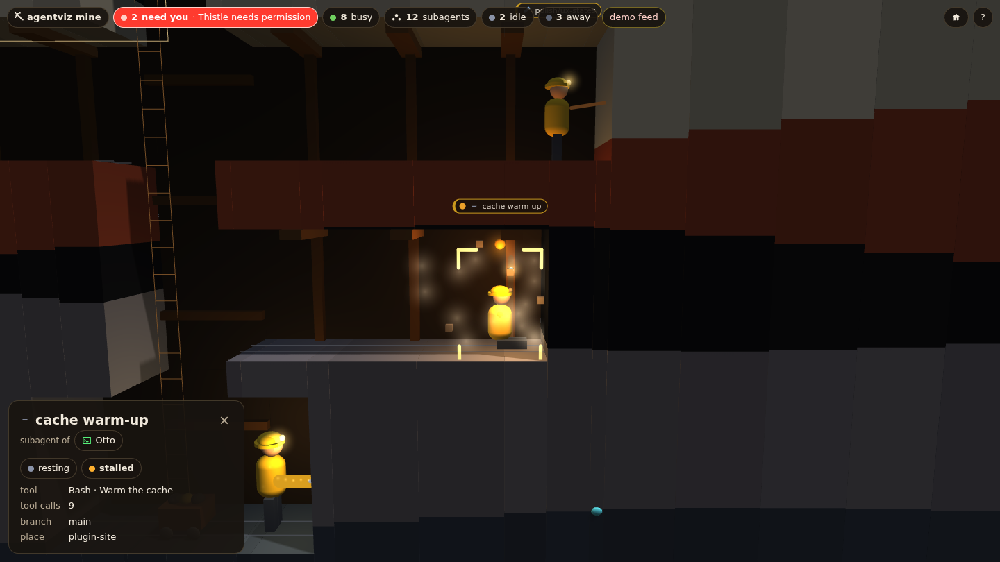
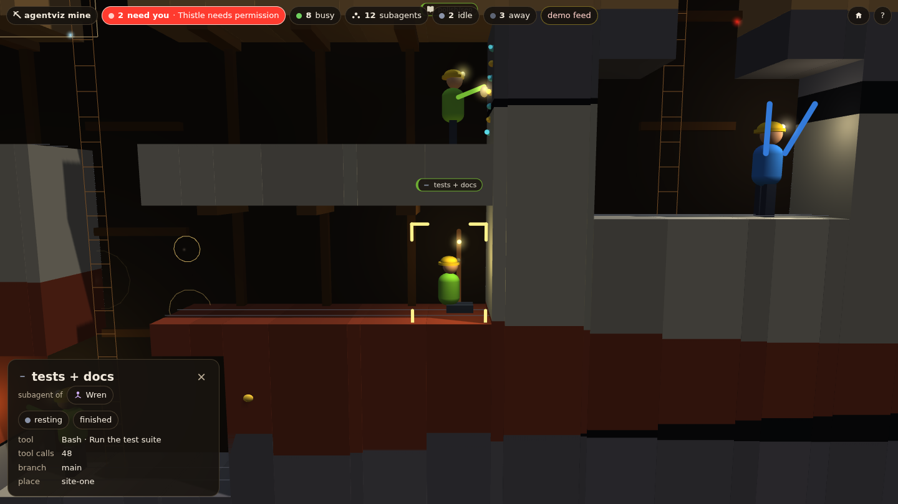
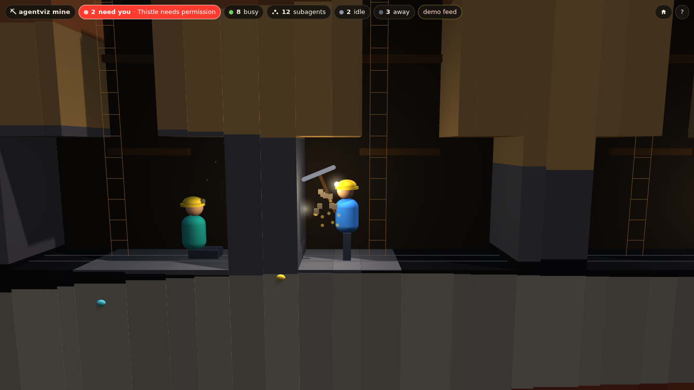
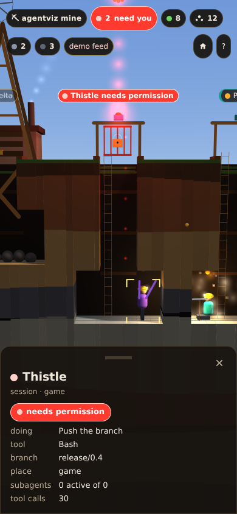
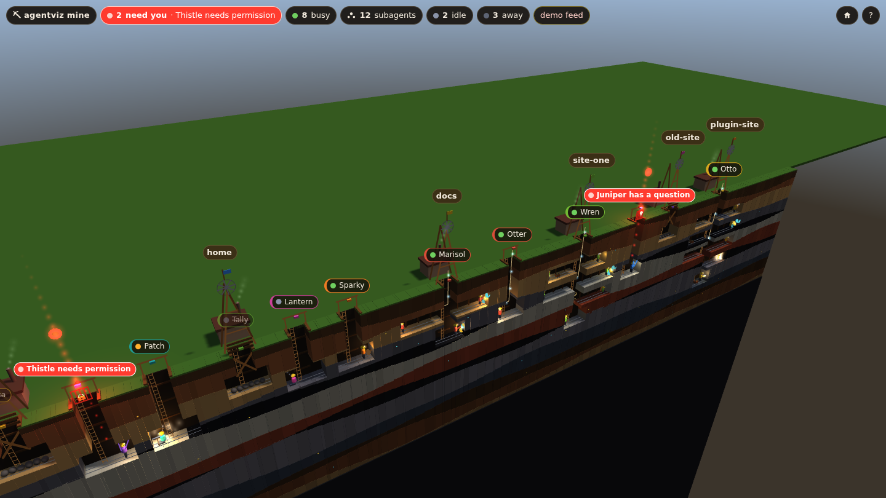

# agentviz-mine

Your Claude Code sessions and their subagents as a **mine seen in
cross-section**, drawn with
[Strata](https://github.com/Preponderous-Software/strata)'s web kit. Each repo
is a pithead on the surface, each session a shaft with a miner at the bottom,
and each subagent a side tunnel off its lead's shaft that grows longer as the
subagent makes more tool calls. When a session needs you, a red cage rattles
at the top of its shaft under a flare and a pillar of red light.

One of the [agentviz](https://github.com/dmccoystephenson/agentviz) family:
ten views of the same feed.


*The demo feed (fixture), from the front. Seven places (repos), fifteen
sessions: two leads with 5 and 7 subagent tunnels, red pillars of light over
Thistle's and Juniper's shafts (waiting on you), boarded-up shafts for the
offline sessions. Busier places are sunk deeper.*


*Five seconds of motion: Wren's subagents swing picks, drive drills with ore
carts, hold lamps up to veins and pull the bell rope. One subagent is resting.*

## Run

Needs Python 3.8 or newer and nothing else:

```bash
git clone https://github.com/dmccoystephenson/agentviz-mine
cd agentviz-mine
python3 -m vendor.agentfeed serve --web web --port 8845            # your live sessions
python3 -m vendor.agentfeed serve --web web --port 8845 --fixture  # the demo feed
```

Open <http://127.0.0.1:8845/> (the server binds 127.0.0.1 only and refuses
non-local `Host` headers). Live mode reads your Claude Code session files
under `~/.claude` and shows session names, states, git branches, tool names
and short labels (a file's basename, a Bash command's own description, a web
host, a subagent's description), never file contents, commands or prompts;
see the agentviz [SECURITY.md](https://github.com/dmccoystephenson/agentviz/blob/main/SECURITY.md).
Query options: `?fixture=1` (demo feed against a live server), `?fps=1`
(frame stats), `?quality=0|1|2`.

Tap or click a miner (or a shaft) for its card (a bottom sheet on a phone;
swipe it down or tap the cross to close): name, state, action, what it is
doing, branch, place, tool calls and its subagents; tap a subagent to fly to
its tunnel, where its card shows its own branch. The red **need you** chip
names who is waiting and why (a question, or a permission prompt), flies to
that shaft and cycles through them; the house button shows the whole mine
again; **?** opens the legend. If the feed stops answering, a banner says so
and the last snapshot stays; with no sessions at all, a hint says how to
start. Drag to orbit, right-drag or two fingers to pan, wheel or pinch to
zoom.

## What you are looking at

| You see | It means | Close-up |
|---|---|---|
| Headframe with a turning wheel and a pennant | a **place** (working-directory basename). The wheel turns and the winding house smokes while any session there is busy | [hero](docs/media/hero.png) |
| How deep a place's shafts go | how many tool calls its sessions have made (the place's `toolCount`) | [hero](docs/media/hero.png) |
| Shaft from the surface down to a lit chamber, a miner at the face | a **session**. Its shirt colour (the tag on its collar, the edge of its label) is its own colour | [lead-subagents](docs/media/lead-subagents.png) |
| Side tunnel off a shaft, a smaller miner in the same shirt colour at its end | a **subagent** of that session. Tunnel length grows with its `toolCount` | [lead-subagents](docs/media/lead-subagents.png) |
| Pickaxe swinging, sparks off the rock | action `edit` | [tool-call](docs/media/tool-call.png) |
| Rock drill at the face, ore cart rolling back and forth | action `run` | [lead-subagents](docs/media/lead-subagents.png) |
| Lamp held up to a glittering vein of ore | action `read` | [lead-subagents](docs/media/lead-subagents.png) |
| Bell rope to the surface, blue signals racing up it | action `web` | [mine.gif](docs/media/mine.gif) |
| Miner pointing while new tunnel mouths open in the shaft walls | action `delegate` | [mine.gif](docs/media/mine.gif) |
| Miner sitting by his upturned pick, thoughts rising | action `think` | [stalled](docs/media/stalled.png) |
| Shovelling spoil over the shoulder | action `other` | |
| Chips of rock bursting off the face with a white flash | a **new tool call** (the session's `lastToolAt` moved, or a subagent's `toolCount` rose) | [tool-call](docs/media/tool-call.png) |
| **Red cage rattling at the shaft top, red flare overhead, a red pillar of light, the miner waving, a red label and the chip in the top bar** | state **`waiting`**: the session needs you | [waiting](docs/media/waiting.png) |
| A padlock on the cage / a "?" on it; the label says "needs permission" / "has a question" | why it waits (`waitingReason`) | [waiting](docs/media/waiting.png), [question](docs/media/question.png) |
| Miner sitting, lamp dimmed, breath drifting | state `idle` (and `dim`) | [idle-offline](docs/media/idle-offline.png) |
| Planks nailed over the collar, boards crossed in the shaft, rubble, no miner | state `offline` | [idle-offline](docs/media/idle-offline.png) |
| Dust churning round the face, pebbles falling, a blinking amber lamp | `stalled`: a session busy with nothing written for 5 minutes, or a subagent quiet that long without finishing | [stalled](docs/media/stalled.png), [stalled-subagent](docs/media/stalled-subagent.png) |
| Tunnel still lit by a lamp hung on a prop, miner sitting | a **resting** subagent (quiet for 2 minutes) | [resting-subagent](docs/media/resting-subagent.png) |
| Yellow corner brackets and a bobbing marker | the selected agent | [resting-subagent](docs/media/resting-subagent.png) |

## Screenshots

All from the fixture feed (`--fixture` / `?fixture=1`), never live sessions.


*A lead with its subagents: Otto's shaft with seven tunnels branching off it
at four levels, each subagent in Otto's shirt colour doing its own action.
The resting one at the bottom ("cache warm-up") is also stalled: dust and an
amber lamp.*


*`waiting`: the cage at Thistle's collar rattles under a red flare and a
pillar of red light, with a padlock on it (a permission prompt); a red
signal runs up the shaft from the miner, who waves both arms.*


*Juniper waits on a question: a "?" on the cage, and the label says so.*


*`idle` and `offline`: Lantern sits with a dimmed lamp; Tally's shaft is
boarded up with rubble in the chamber.*


*Patch is `stalled` (busy, but nothing written for 5 minutes): dust churns
round the face, pebbles drop and an amber warning lamp blinks. Next door,
Thistle waves for the cage.*


*A stalled subagent ("cache warm-up", quiet for over 5 minutes without
finishing): the same dust and amber lamp, scaled to its tunnel. Selected,
so it carries the yellow brackets.*


*A resting subagent ("tests + docs"): its tunnel stays lit by a lamp hung on
a prop while the miner sits.*


*A new tool call: chips of rock burst off Anvil's face with a white flash
(held at 70% strength for the still; live, it fades over about a second).*


*Otto selected: the card shows state, action, what it is doing, branch,
place, tool calls and each subagent as a chip you can tap to fly to its
tunnel.*



*Phone portrait (390 × 844, DPR 3): Thistle selected, the card as a bottom
sheet saying why it waits.*


*From above and to one side: the cut face is a slab, the land runs back to
the horizon.*


*From low on the left, looking along the workings.*

## Build and test

```bash
python3 -m unittest discover -s tests       # serves the fixture; page, assets, feed, vendored PINs
npm ci && npx playwright install chromium   # Playwright 1.61.1, for the browser tests
pip install -r requirements-dev.txt         # Pillow, for the GIF
npm run smoke                               # headless Chromium on the demo feed; saves docs/media/screenshot.png
npm run screenshots                         # every image above (or some: npm run screenshots -- hero phone mine)
EMSDK=/path/to/emsdk vendor/agentviz-kit/scene/build-scene.sh scene/kit.conf   # rebuild web/mine-engine.*
```

The built engine files are committed, so serving needs only Python. Tests
use port 9112 (`MINE_TEST_PORT` overrides). `vendor/agentfeed/`,
`vendor/agentviz-kit/` and `web/agentviz-*` come from
[agentviz](https://github.com/dmccoystephenson/agentviz) (`tools/vendor-kit.sh`);
do not edit them here.

## How it works

The feed client, the HUD (chips, the selected-agent card and bottom sheet,
the banner, the empty state), world labels, tap picking and the
page-to-engine data format are the shared agentviz kit (docs/KIT.md in
agentviz). On top of it, `web/mine-model.js` keys everything by id, lays the
places out left to right with a shaft per session and a tunnel per subagent
(alternating sides, two to a level), and eases them between snapshots. Each
frame `web/mine-frame.js` packs the scene in the agentviz wire format;
`scene/main.cpp` decodes it with `agentviz.h` (`workings.h`) and draws the
banded earth with the workings cut out (`earth.h`), the headframes, timber,
cages and stalls (`structures.h`) and the miners (`miner.h`) with Strata's
primitives, lines, points and point lights.

## Licence

Code: [MIT](LICENSE). Screenshots and GIFs in `docs/media/`:
[CC0 1.0](LICENSE-media). The committed engine bundles Strata (MIT) and its
libraries, and the Emscripten runtime: see
[THIRD_PARTY_NOTICES.md](THIRD_PARTY_NOTICES.md).
