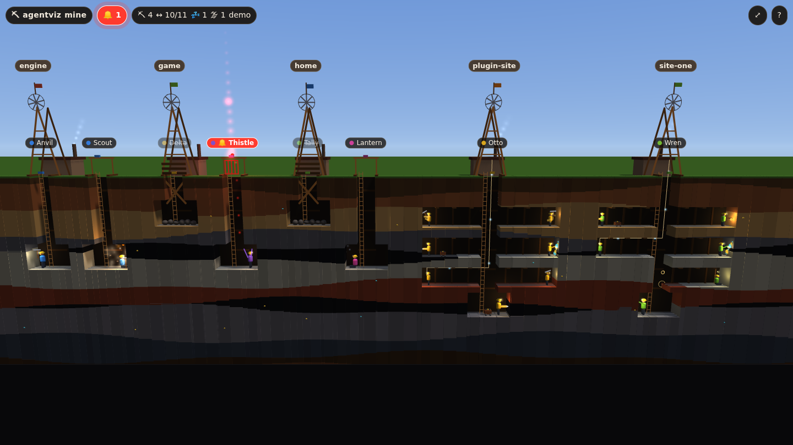
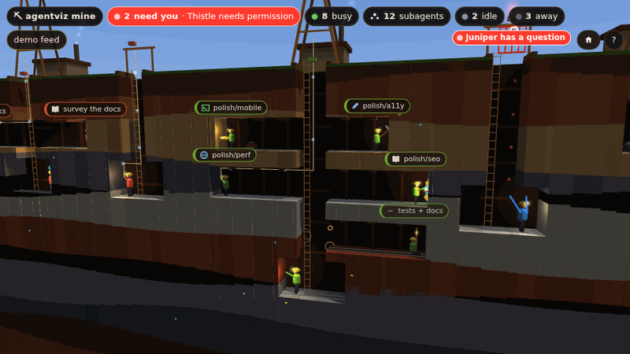
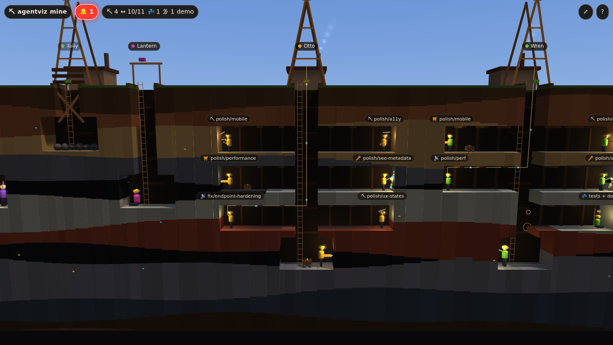
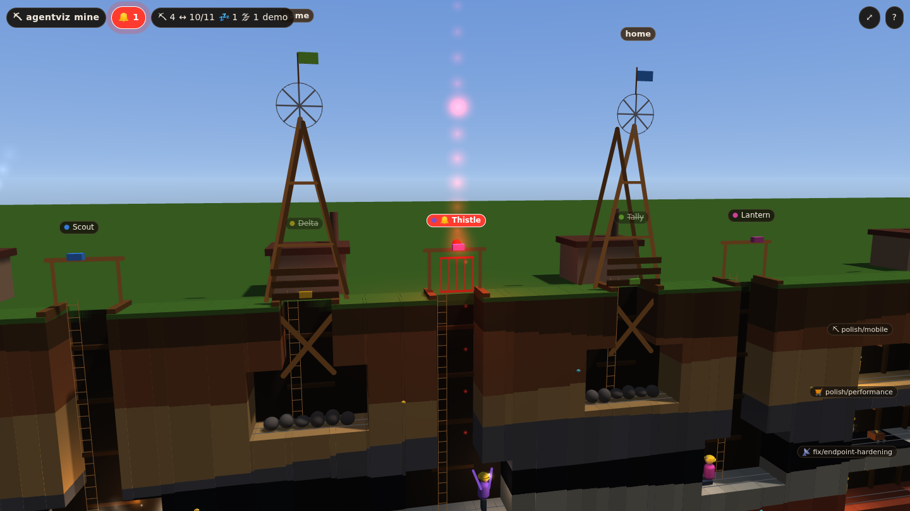
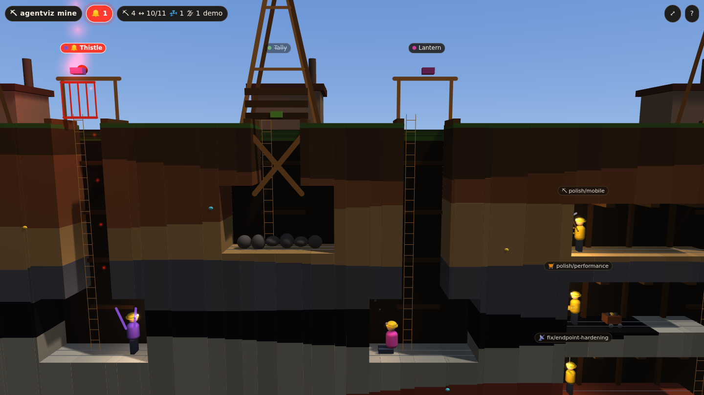
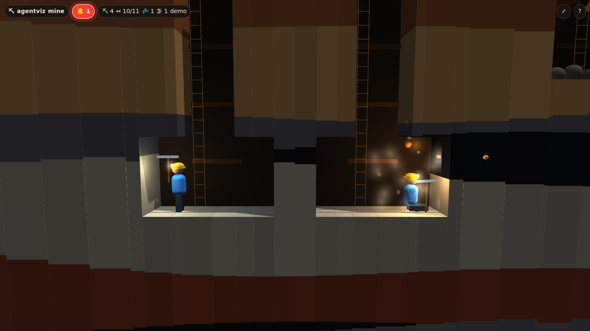
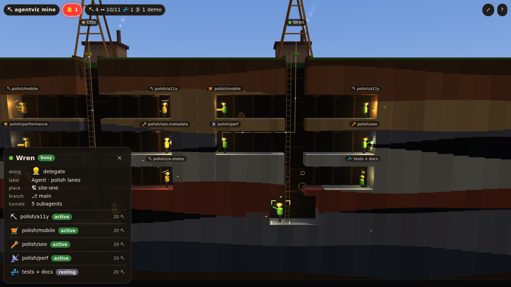
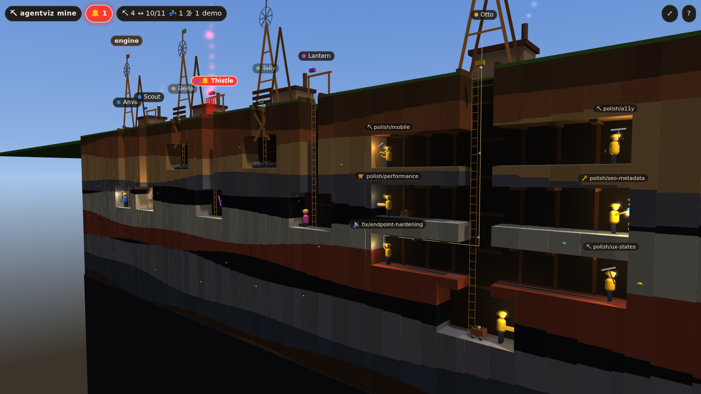

# agentviz-mine

Claude Code sessions and their subagents as a **mine seen in cross-section**,
drawn with [Strata](https://github.com/Preponderous-Software/strata)'s web kit.
Each repo is a pithead on the surface, each session a shaft with a miner at the
bottom, and each subagent a side tunnel off its lead's shaft that grows longer
as the subagent makes more tool calls. One of the
[agentviz](https://github.com/dmccoystephenson/agentviz) family; it reads only
the shared `/api/agents` feed.


*The demo feed (fixture), from the front. Five places (repos), eight sessions:
two leads with 5 and 6 subagent tunnels (right), a red pillar of light over
Thistle's shaft (waiting on you), boarded-up shafts for the offline sessions.*


*Five seconds of motion: Wren's subagents swing picks, drive drills with ore
carts, hold lamps up to veins and pull the bell rope. One subagent is resting.*

## What you are looking at

| You see | It means |
|---|---|
| Headframe with a turning wheel and a pennant | a **place** (working-directory basename). The wheel turns and the winding house smokes while any session there is busy |
| Shaft from the surface down to a lit chamber, a miner at the face | a **session**. Its shirt colour (and the tag on its collar) is its own colour |
| Side tunnel off a shaft, a smaller miner in the same shirt colour at its end | a **subagent** of that session. Tunnel length grows with its `toolCount` |
| Pickaxe swinging, sparks off the rock | action `edit` |
| Rock drill at the face, ore cart rolling back and forth | action `run` |
| Lamp held up to a glittering vein of ore | action `read` |
| Rope to the surface, blue signals racing up it (panel icon 📡) | action `web` |
| Miner pointing while new tunnel mouths open in the shaft walls (panel icon 👷) | action `delegate` |
| Miner sitting on his upturned pick, thoughts rising | action `think` |
| Shovelling spoil over the shoulder | action `other` |
| **Red cage rattling at the shaft top, red flare bursting overhead, a red pillar of light, the miner waving, a red name tag and a bell in the top bar** | state **`waiting`**: the session needs you |
| Miner sitting, lamp dimmed, breath drifting | state `idle` (and `dim`) |
| Planks nailed over the collar, boards crossed in the shaft, rubble, no miner | state `offline` |
| Dust churning round the face, pebbles falling, flickering amber glow | `stalled` (busy, but nothing written for 5 minutes) |
| Tunnel still lit by a lamp hung on a prop, miner sitting (💤) | a **resting** subagent (quiet for 2 minutes) |
| Yellow corner brackets and a bobbing marker | the selected agent |

Tap or click a miner (or a shaft) to select it: a panel (a bottom sheet on a
phone) shows its name, state, action, label, branch, place and its subagents;
tap a subagent in the list to fly to its tunnel. The red bell button in the top
bar cycles through sessions waiting on you. `⤢` shows the whole mine again,
`?` opens the legend. Drag to orbit, right-drag or two fingers to pan, wheel or
pinch to zoom.

## Close-ups


*A lead with its subagents: Otto's shaft with six tunnels branching off it at
three levels, each subagent in Otto's shirt colour doing its own action.*


*`waiting`: the cage at Thistle's collar rattles under a red flare and a pillar
of red light; a red signal runs up the shaft from the miner, who waves both arms.*


*`idle` and `offline`: Lantern sits with a dimmed lamp; Tally's shaft is boarded
up with rubble in the chamber.*


*Two solo sessions in one place: Anvil swings a pick (`edit`); Scout sits on
the pick (`think`) and is `stalled` (busy, but nothing written for 5 minutes):
dust churns round the face, pebbles drop and an amber warning lamp blinks.*


*A resting subagent ("tests + docs"): its tunnel stays lit by a lamp hung on a
prop while the miner sits. Selected, so it carries the yellow brackets.*

## Panel, phone and other angles


*Wren selected: the panel lists the lead's state, action, label, place, branch
and each subagent with its action icon and tool-call count.*


*Phone portrait (390 × 844, DPR 3): Thistle selected, the bottom sheet open.*


*From above and to one side: the cut face is a slab, the land runs back to the horizon.*


*From low on the left, looking along the workings.*

## Run

```bash
python3 -m vendor.agentfeed serve --web web --port 8845            # live sessions on this machine
python3 -m vendor.agentfeed serve --web web --port 8845 --fixture  # the demo feed
```

Open http://127.0.0.1:8845/ (or `/?fixture=1` for the demo feed against a live
server; `?fps=1` shows frame stats). The server binds 127.0.0.1 only.

## Build

The built `web/mine-engine.js` and `.wasm` are committed, so serving needs
only Python. To rebuild after changing `scene/main.cpp`:

```bash
scene/build.sh   # Strata 0.10.0 wasm tarball (SHA-256 checked) into .strata/, emsdk 6.0.11
```

`scene/main.cpp` draws; `web/mine.js` polls the feed every 2 s, lays out the
mine, eases between snapshots (keyed by id), picks and fills the panel.

## Test

```bash
python3 -m unittest discover -s tests                            # page, assets, feed
NODE_PATH=/root/arcade-watch/node_modules node tests/smoke.cjs    # headless Chromium: draws, bell, tap -> panel
NODE_PATH=/root/arcade-watch/node_modules node tests/screenshots.cjs  # regenerates docs/media/ (fixture only)
```

All images here come from the synthetic fixture feed, never from live sessions.
